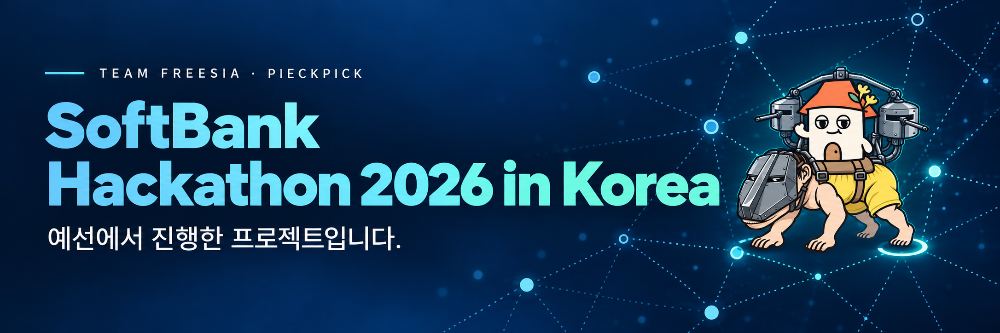
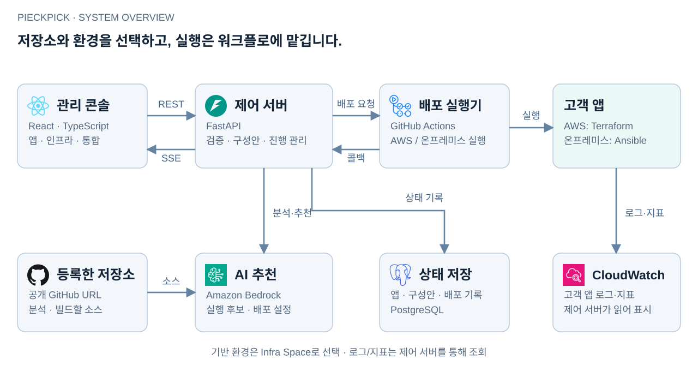
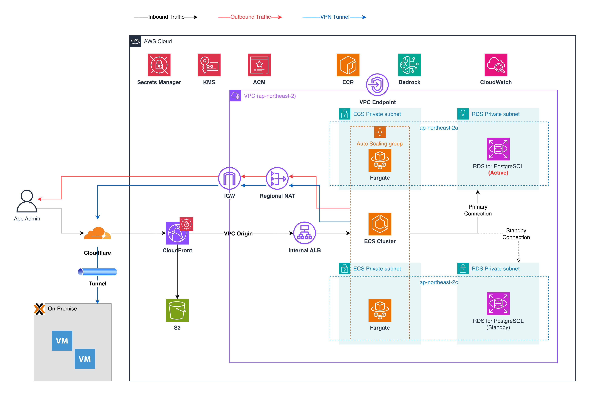
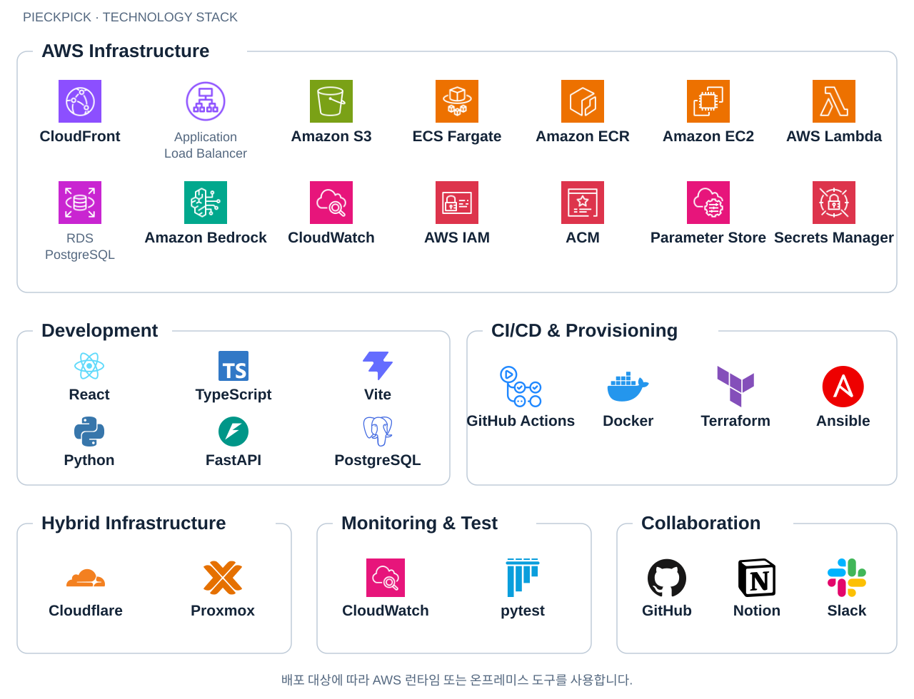

<!-- GitHub organization profiles resolve relative links against the organization URL. Keep repository files and images absolute. -->

  

<h1 align="center">PieckPick</h1>

SoftBank Hackathon 2026 in Korea · 예선 · Team Freesia

<strong>인프라 담당자는 환경을 준비하고, 개발자는 앱 배포에 집중합니다.</strong>

공개 GitHub 저장소를 AWS 또는 온프레미스에 배포하는 관리 콘솔입니다. AI가 실행 환경과 설정값을 추천하고, 개발자가 구성안을 검토한 뒤 배포를 요청합니다.

  <a href="https://sbh.howon.me/">서비스 콘솔</a> ·
  <a href="https://app.notion.com/p/3ed8bee9ada4809eb9bcc5fdd1f07082">최종 발표</a> ·
  <a href="#purpose">기획 의도</a> ·
  <a href="#features">배포 흐름</a> ·
  <a href="#architecture">아키텍처</a> ·
  <a href="#repositories">저장소</a> ·
  <a href="#team">팀 구성원</a>

## 기획 의도

> “어느 서브넷에 넣을까요?” “포트는요?” “CPU와 메모리는 얼마나 필요하죠?”

팀이 앱을 배포할 때마다 개발자와 인프라 담당자는 네트워크와 실행 조건을 다시 맞춰야 했습니다. PieckPick에서 인프라 담당자는 공통 배포 환경을 **Infra Space**로 준비합니다. 개발자는 앱에 맞는 환경을 골라 저장소를 연결하고, 배포 진행 상황과 결과를 한곳에서 확인합니다.

## 배포 흐름

1. **연결** — `통합`에서 공개 GitHub 저장소를 등록하고, `애플리케이션`에서 저장소와 Infra Space를 연결합니다.
2. **분석과 검토** — AI가 코드를 분석해 실행 환경 후보와 근거를 제시합니다. 개발자는 후보를 선택하고 템플릿과 설정값을 검토합니다.
3. **배포** — 개발자가 요청하면 GitHub Actions가 AWS에서는 Terraform, 온프레미스에서는 Ansible을 실행합니다. 콘솔은 Server-Sent Events(SSE)로 진행 상황을 받아 표시합니다.
4. **결과 확인** — `전체 구성`에서 보고된 자원이나 Ansible 작업을 확인합니다. 지원되는 AWS 앱의 로그와 지표는 별도 탭에서 조회합니다.

[화면과 사용 흐름 보기](https://github.com/softbank-hackathon-2026/.github/blob/main/docs/frontend-flow.md) · [AI 추천 과정 보기](https://github.com/softbank-hackathon-2026/.github/blob/main/docs/ai-recommendation.md)

## 전체 시스템 아키텍처

| 구성 요소 | 책임 |
|---|---|
| **관리 콘솔 · React** | 환경·저장소·앱 선택, 구성 검토, 진행과 결과 표시 |
| **제어 서버 · FastAPI** | 입력 검증, 분석과 구성안 관리, 워크플로 실행 요청, 상태 저장·조회 |
| **AI · Amazon Bedrock** | 저장소와 제공된 실행 후보를 바탕으로 구성 추천 |
| **실행기 · GitHub Actions** | 소스 빌드와 템플릿 기반 배포, 결과 콜백 |
| **관찰 · CloudWatch** | 지원되는 AWS 고객 앱의 지표·로그를 백엔드가 읽어 콘솔에 전달 |

**AI가 추천하고 GitHub Actions가 실행합니다.** 제어 서버는 개발자가 검토한 템플릿과 설정값으로 워크플로를 요청하고, 실행 결과를 콘솔에 전달합니다.

[상세 시스템 구조도](https://github.com/softbank-hackathon-2026/.github/blob/main/assets/architecture/system-detail.svg) · [CI/CD 실행 흐름](https://github.com/softbank-hackathon-2026/.github/blob/main/docs/cicd.md) · [모니터링 구성](https://github.com/softbank-hackathon-2026/.github/blob/main/docs/monitoring.md)

## 인프라 아키텍처

*[최종 발표](https://app.notion.com/p/3ed8bee9ada4809eb9bcc5fdd1f07082)의 인프라 아키텍처 원본 이미지입니다.*

**플랫폼 자체의 진입점은 CloudFront로 모으고, 내부 자원은 Private 영역에 둡니다.**

- **화면:** CloudFront → OAC → 비공개 S3.
- **API:** CloudFront → VPC Origin → internal ALB → ECS Fargate.
- **데이터:** ECS Fargate → Private RDS PostgreSQL.
- **외부 조회:** 플랫폼의 Regional NAT를 통한 GitHub·Bedrock·Cloudflare 연결.
- **하이브리드:** 백엔드의 Proxmox VM 조회와 GitHub Actions의 온프레미스 앱 배포 경로를 분리.

플랫폼을 운영하는 계정과 고객 앱을 실행하는 계정을 구분합니다. **플랫폼의 Private 구조와 고객 앱 템플릿의 네트워크 구조는 각각 다릅니다.** 고객 앱은 선택한 실행 환경에 따라 ECS Fargate·EC2·Lambda 또는 온프레미스 VM·컨테이너로 배포하는 코드 경로를 갖습니다.

[인프라 구성과 네트워크 상세](https://github.com/softbank-hackathon-2026/.github/blob/main/docs/infrastructure.md) · [AWS Organizations와 계정 역할](https://github.com/softbank-hackathon-2026/.github/blob/main/docs/aws-organizations.md)

## 기술 스택

| 영역 | 주요 기술 |
|---|---|
| **Frontend / Backend** | React, TypeScript, Vite / Python, FastAPI, SQLAlchemy, PostgreSQL |
| **AWS 플랫폼과 앱 실행** | CloudFront, S3, ALB, ECS Fargate, ECR, RDS, EC2, Lambda, IAM, ACM, Parameter Store, Secrets Manager |
| **AI / 관찰** | Amazon Bedrock / Amazon CloudWatch |
| **자동화 / 하이브리드** | GitHub Actions, Docker, Terraform, Ansible, Cloudflare Tunnel·Access, Proxmox |
| **테스트 / 협업** | pytest, Playwright / GitHub, Notion, Slack |

## 소스 저장소

서비스 이름은 **PieckPick**이며, 프런트엔드와 백엔드 저장소에는 팀 이름 **Freesia**를 사용합니다.

| 저장소 | 포함하는 내용 |
|---|---|
| [Freesia-Frontend](https://github.com/softbank-hackathon-2026/Freesia-Frontend) | 관리 콘솔, API 연동, 화면 검증 |
| [Freesia-backend](https://github.com/softbank-hackathon-2026/Freesia-backend) | 앱·인프라·분석·배포·모니터링 API |
| [platform-terraform](https://github.com/softbank-hackathon-2026/platform-terraform) | 플랫폼의 AWS 기반 인프라 |
| [workload-terraform](https://github.com/softbank-hackathon-2026/workload-terraform) | 고객 앱을 위한 기반 환경 |
| [workload-deploy](https://github.com/softbank-hackathon-2026/workload-deploy) | AWS·온프레미스 앱 실행·정리 워크플로와 템플릿 |

샘플 앱 · [sample-shop](https://github.com/softbank-hackathon-2026/sample-shop) · [shop-api](https://github.com/softbank-hackathon-2026/shop-api)

## 상세 문서

| 주제 | 문서 |
|---|---|
| 콘솔과 AI | [화면 흐름](https://github.com/softbank-hackathon-2026/.github/blob/main/docs/frontend-flow.md) · [AI 추천](https://github.com/softbank-hackathon-2026/.github/blob/main/docs/ai-recommendation.md) |
| 인프라 | [네트워크 구성](https://github.com/softbank-hackathon-2026/.github/blob/main/docs/infrastructure.md) · [AWS 계정과 권한](https://github.com/softbank-hackathon-2026/.github/blob/main/docs/aws-organizations.md) |
| 배포와 운영 | [CI/CD](https://github.com/softbank-hackathon-2026/.github/blob/main/docs/cicd.md) · [모니터링](https://github.com/softbank-hackathon-2026/.github/blob/main/docs/monitoring.md) |

## 현재 범위와 다음 목표

- **코드에서 확인한 범위**는 저장소 등록, AI 분석과 구성 검토, 배포 워크플로 실행 요청과 콜백, 진행·자원 표시, 지원되는 AWS 앱의 로그와 지표 조회입니다.
- **별도 환경 검증이 필요한 범위**는 실행 환경별 배포와 앱 접속, 공유 ALB의 앱별 지표, 온프레미스 SSH·배포 연결입니다. 인프라 생성 화면의 AI 대화와 Terraform Apply는 데모입니다.
- **다음 목표**는 인프라 변경에 따른 AI 재추천과 AWS Transit Gateway(TGW) 중심의 통합 네트워크입니다.

2026-10-05에 확인한 고정 소스와 최종 발표를 기준으로 정리했습니다. [소스와 이미지 출처](https://github.com/softbank-hackathon-2026/.github/blob/main/docs/sources.md)

## 팀 구성원

**Team Freesia · 6명**

<table>
  <thead>
    <tr>
      <th align="center">김동윤</th>
      <th align="center">박태원</th>
      <th align="center">강효승</th>
      <th align="center">정호원</th>
      <th align="center">박준서</th>
      <th align="center">박소정</th>
    </tr>
  </thead>
  <tbody>
    <tr>
      <td align="center"><strong>Frontend Monitoring</strong></td>
      <td align="center"><strong>Backend</strong></td>
      <td align="center"><strong>AI</strong></td>
      <td align="center"><strong>Infra</strong></td>
      <td align="center"><strong>Infra</strong></td>
      <td align="center"><strong>DevOps CI/CD</strong></td>
    </tr>
    <tr>
      <td align="center"></td>
      <td align="center"></td>
      <td align="center"></td>
      <td align="center"></td>
      <td align="center"></td>
      <td align="center"></td>
    </tr>
    <tr>
      <td align="center"><a href="https://github.com/BusanGukbap">@BusanGukbap</a></td>
      <td align="center"><a href="https://github.com/BokJaeSung">@BokJaeSung</a></td>
      <td align="center"><a href="https://github.com/Recklehs">@Recklehs</a></td>
      <td align="center"><a href="https://github.com/ONE0x393">@ONE0x393</a></td>
      <td align="center"><a href="https://github.com/Junseo-tech">@Junseo-tech</a></td>
      <td align="center"><a href="https://github.com/sojjeoi">@sojjeoi</a></td>
    </tr>
  </tbody>
</table>

역할은 [최종 발표 자료](https://app.notion.com/p/3ed8bee9ada4809eb9bcc5fdd1f07082)의 분담을 따릅니다.
